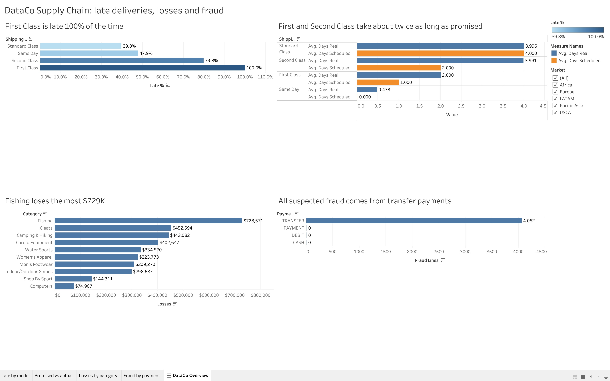

# DataCo Supply Chain Analysis

Analysis of 180,519 order lines (2015–2018) from the public DataCo Smart Supply Chain
dataset, using **PostgreSQL**, **SQL**, and **Tableau**, to find why deliveries are late,
where the company loses money, and where fraud occurs.

## Key findings

**1. Late deliveries come from unrealistic promises, not slow shipping**
- 57.3% of shipped order lines arrive late
- First Class promises 1 day but always takes 2 → late 100% of the time
- Second Class promises 2 days but takes ~4 — the same as Standard Class, so customers
  paying extra get no real speed advantage
- Modelled fix: correcting First Class (+1 day) and Second Class (+2 days) promises
  cuts late deliveries from 57.3% to 34.1%

**2. Money-losing orders wipe out nearly half of profit**
- Sales $36.7M, net profit $3.97M
- 33,784 order lines (18.7%) lost money, totalling $3.88M (10.6% of sales)
- Losses are similar across markets once size is accounted for, but vary widely by
  product category (about 11%–19% of sales in the worst ten); Fishing has the largest
  dollar loss ($729K)

**3. All suspected fraud comes from transfer payments**
- 4,062 suspected-fraud lines, all paid by TRANSFER (8.1% of transfer lines)
- No suspected fraud recorded for other payment types
- Recommendation: targeted verification for transfers rather than blocking them,
  since ~92% of transfers are genuine

## Tools
- **PostgreSQL** (Postgres.app, pgAdmin) — data storage, cleaning, analysis
- **SQL** — aggregation, FILTER, CASE WHEN, CTEs (WITH), scenario modelling
- **Python** — loading the raw CSV into PostgreSQL
- **Tableau** — interactive dashboard with a market filter

## Project structure
- `sql/00_setup.sql` — creates the database and a read-only user
- `sql/01_clean.sql` — builds the clean `orders` table, with data checks
- `sql/02_analysis.sql` — all analysis queries, each with its question and result
- `dashboard/dashboard.png` — dashboard screenshot
- `dashboard/DataCo Supply Chain Performance.twbx` — Tableau packaged workbook
- `load_raw.py` — loads the raw CSV into PostgreSQL
- `notes.md` — detailed findings and learning notes

## How to reproduce
1. Download `DataCoSupplyChainDataset.csv` from Kaggle ("DataCo Smart Supply Chain for
   Big Data Analysis") into `data/`, and convert it to UTF-8:
   `iconv -f ISO-8859-1 -t UTF-8 data/DataCoSupplyChainDataset.csv > data/dataco_utf8.csv`
2. Install PostgreSQL, then run `psql -f sql/00_setup.sql`
3. Run `pip install -r requirements.txt`, then `python load_raw.py`
4. Run `psql -d dataco -f sql/01_clean.sql`
5. Run the queries in `sql/02_analysis.sql`

## Limitations
- The delivery model assumes actual shipping times stay the same, and is tested on the
  same data it was built from
- "Suspected fraud" is a label in the dataset; 0% for other payment types may reflect
  how fraud was flagged, not proof of no fraud
- Data covers 2015–2018 only